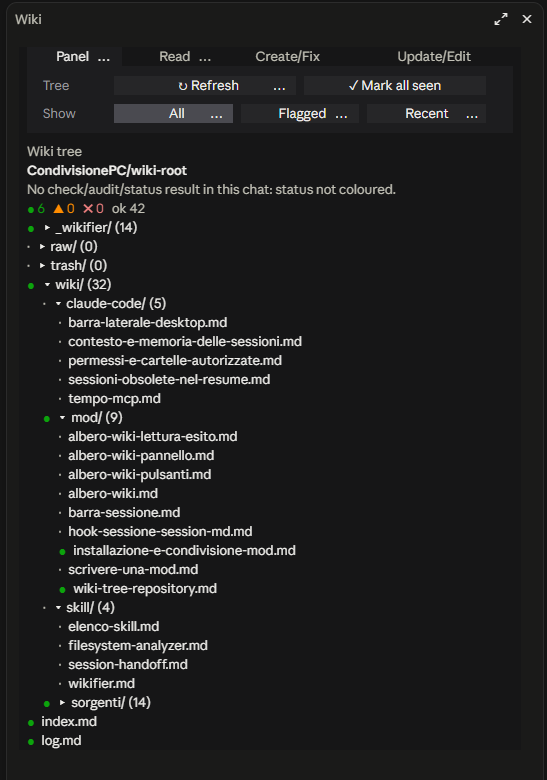
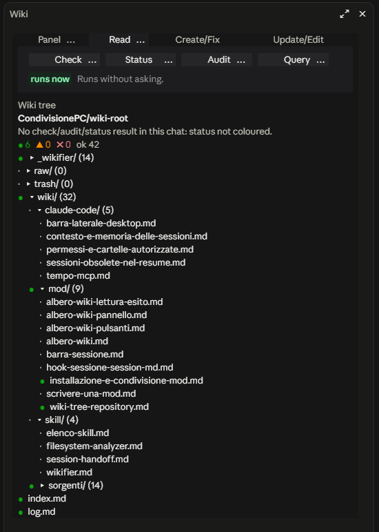
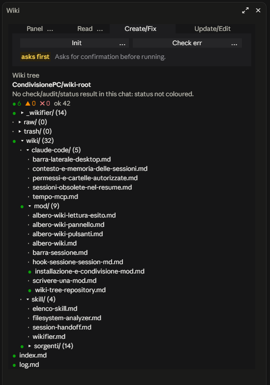
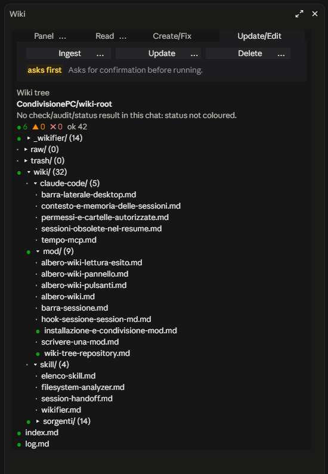
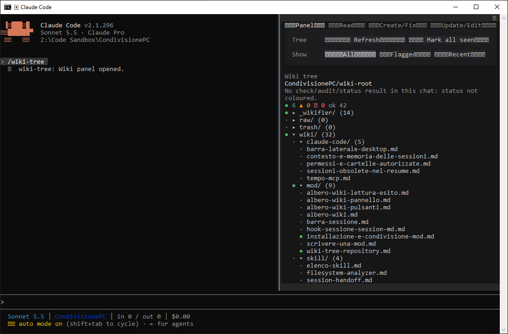

# wikifier-panel-mod

A Claude Code mod that adds a side panel for wikis managed by the [wikifier](https://github.com/GrossoRoberto/wikifier) skill. It ships one plugin, `wiki-tree`.

**Status:** version 0.6.0, first public release. It was developed and used by the author on Claude Code Desktop, where the English version installed from this repository opens and shows the panel (see the screenshots below); it has not been tested elsewhere. The logic tests (`wiki-tree/hooks/logic.test.ts`) were not run by the author after the English translation: see [Tests](#tests).

## Screenshots

The four tabs of the panel in Claude Code Desktop. There was no `wiki-check` / `wiki-audit` / `wiki-status` result in that chat, so the screenshots show no status colours; the green dots mark pages not yet seen.

| Panel | Read |
|---|---|
|  |  |

| Create/Fix | Update/Edit |
|---|---|
|  |  |

The small dots on the buttons come from the padding character that makes the whole button area clickable.

### Known limitation: Windows console

In the classic Windows console (the `cmd` / PowerShell window) the buttons are filled with squares, because the padding character (empty braille, U+2800) has no glyph in the console font. Claude Code's own symbols, such as the "auto mode" marker, show as squares in the same window. The panel still works. Windows Terminal or another font with braille glyphs may fix it; this was not tested.



## What it does

Open it with `/wiki-tree`. The panel shows:

- **The wiki tree.** Folders and pages of the wiki root, with a counter per folder. `wiki/` is open by default.
- **Status colours.** Pages that are new or changed since you last clicked them are green (●). Pages flagged in the latest `wiki-check`, `wiki-audit` or `wiki-status` result in the chat are orange (▲, warnings) or red (✖, errors). The colours come from a snapshot of that result and can be out of date.
- **Filters.** All, Flagged, Recent.
- **Command buttons.** Read-only commands (`wiki-check`, `wiki-status`, `wiki-audit`) run at once. Commands that write (`wiki-init`, `wiki-check err`, `wiki-ingest`, `wiki-update`, `wiki-delete`) ask for confirmation in the panel and then only fill the message box: you press enter yourself. `wiki-query` fills the box too.
- **Ask how to fix it.** Clicking a flagged page shows the reasons and a button that puts a "propose a fix, change nothing until I approve" request in the message box.

## Requirements

- **Claude Code with mod support** (the `claude-code` mod API used by `register.tsx`).
- **The [wikifier](https://github.com/GrossoRoberto/wikifier) skill**, installed. The mod does not work without it: it only reads the wiki that the skill creates and shows the results of its commands.
- **An `infowiki.md` in the project root** (the directory where the session starts), with at least:

  ```
  ---
  project_name: My Project
  path: Z:\Wiki_Root\MyProject
  path_alt:
  ---
  ```

  The mod reads `path`, and `path_alt` as a fallback. See the wikifier README for the full format.

The mod does not change the wiki by itself. The only things it stores are the "seen" marks of the pages, in the mod's own store.

## Install

From a terminal:

```
claude plugin marketplace add GrossoRoberto/wikifier-panel-mod
claude plugin install wiki-tree@wikifier-panel-mod --scope user
```

Then run `/reload-plugins` (or start a new session) and `/wiki-tree`. The author ran these two commands on Windows and `/wiki-tree` opened the panel. The `/plugin ...` slash-command forms, and other operating systems, were not tested. The exact commands depend on your Claude Code version; check `claude plugin --help`.

## Languages

The panel is in English. The wikifier skill answers in the language set in `infowiki.md` (`language`, default `it`), so the mod recognises check, status and audit results in both English and Italian (for example `State` / `Stato`, `Root` / `Radice`, `Pages` / `Pagine`). `DA VERIFICARE` and `CONTRADDIZIONE` are literal markers that the skill writes into pages whatever the language, so they are recognised too, together with the English equivalents `TO BE VERIFIED`, `TO BE TESTED`, `TO BE CHECKED` and `CONTRADICTION`. Other languages are not recognised: add their words to the regular expressions at the top of `wiki-tree/hooks/logic.ts`.

## Layout

```
.claude-plugin/marketplace.json   marketplace listing
wiki-tree/
  .claude-plugin/plugin.json      plugin manifest
  hooks/hooks.json                loads register.tsx
  hooks/register.tsx              command, panel and refresh logic
  hooks/logic.ts                  pure functions: parsing results, severity, filters
  hooks/logic.test.ts             tests for logic.ts
  types/index.d.ts                shared types
```

## Tests

`logic.test.ts` imports `expect` and `test` from `claude-code/testing`. The author has no standalone test runner for it, and it was not run after the translation to English. Contributions that add one are welcome.

## Contributing

Issues and pull requests are welcome. The panel text and the code are in English; keep result recognition bilingual unless you add another language.

## License

MIT. See [LICENSE](LICENSE).
